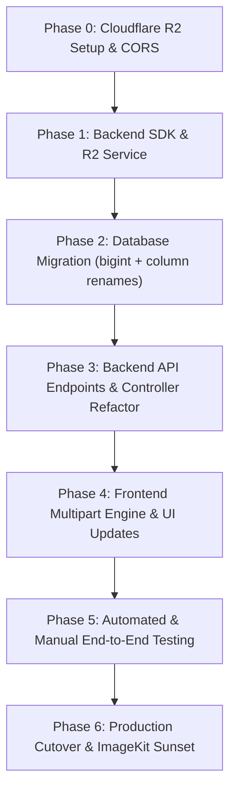

# Cloudflare R2 Migration — Detailed Implementation Plan

**Objective:** Fully migrate document and asset storage from ImageKit.io to Cloudflare R2, enabling secure, low-latency, and zero-egress-cost uploads up to **5 GB** via browser-to-R2 presigned multipart uploads.

---

## Architecture Blueprint

```
[ Frontend: Next.js ]
       │
       │ 1. POST /api/upload/initiate (file meta, node info)
       ▼
[ Backend: Express + Drizzle ] ──(Validate Quota & Auth)──► [ Neon DB ]
       │
       │ 2. CreateMultipartUpload & sign N presigned PUT URLs (100MB parts)
       ▼
[ Cloudflare R2 Private Bucket ]
       ▲
       │ 3. Parallel PUT (4 concurrent streams) directly to R2
       │
[ Frontend: Next.js ]
       │
       │ 4. POST /api/upload/complete (uploadId, parts[{PartNumber, ETag}])
       ▼
[ Backend: Express ] ──(CompleteMultipartUpload)──► [ Cloudflare R2 ]
       │
       │ 5. Save document record (storageKey, md5, fileSize: bigint)
       ▼
[ Neon DB (PostgreSQL) ]
```

---

## Phase Breakdown & Work Breakdown Structure (WBS)



---

### Phase 0: Cloudflare R2 Setup & CORS Configuration
**Estimated Effort:** ~30 mins  
**Goal:** Provision secure Cloudflare R2 bucket and configure network access.

1. **Create R2 Bucket:**
   - Bucket name: `ectd-dossiers`
   - Location hint: `Automatic` (Cloudflare edge routing)
   - Public access: **Disabled** (Private bucket)

2. **Generate API Token:**
   - Permissions: **Object Read & Write**
   - Bucket scope: Limit specifically to `ectd-dossiers`
   - Capture `R2_ACCESS_KEY_ID`, `R2_SECRET_ACCESS_KEY`, and Cloudflare `R2_ACCOUNT_ID`.

3. **Configure Bucket CORS Policy:**
   - Navigate to R2 Bucket > Settings > CORS Policy:
   ```json
   [
     {
       "AllowedOrigins": [
         "https://dossier-project-inky.vercel.app",
         "http://localhost:3000"
       ],
       "AllowedMethods": ["GET", "PUT", "HEAD"],
       "AllowedHeaders": ["Content-Type", "x-amz-*"],
       "ExposeHeaders": ["ETag"],
       "MaxAgeSeconds": 3600
     }
   ]
   ```
   *(Note: Exposing `ETag` is mandatory for multipart completion).*

---

### Phase 1: Backend Dependencies & `r2.service.ts`
**Estimated Effort:** ~1-2 hours  
**Goal:** Introduce AWS S3 SDK for R2 and establish clean service abstractions.

1. **Install SDK Packages in `backend`:**
   ```bash
   cd backend
   npm install @aws-sdk/client-s3 @aws-sdk/s3-request-presigner
   ```

2. **Add Environment Variables (`backend/.env`):**
   ```env
   R2_ACCOUNT_ID="your_account_id"
   R2_ACCESS_KEY_ID="your_access_key_id"
   R2_SECRET_ACCESS_KEY="your_secret_access_key"
   R2_BUCKET_NAME="ectd-dossiers"
   ```

3. **Build `backend/src/services/r2.service.ts`:**
   Implement high-performance S3-compatible service functions:
   - `getR2Client()`: Singleton client with `https://${R2_ACCOUNT_ID}.r2.cloudflarestorage.com`.
   - `initiateMultipartUpload(key, mimeType, fileSize, chunkSize)`: Creates multipart upload and signs all part PUT URLs.
   - `completeMultipartUpload(key, uploadId, parts)`: Assembles uploaded parts.
   - `abortMultipartUpload(key, uploadId)`: Cleans up orphaned parts on cancellation or error.
   - `getPresignedDownloadUrl(key, expiresInSeconds = 3600)`: Generates secure 1-hour GET URL.
   - `uploadBufferToR2(buffer, key, contentType)`: Direct PUT for small files (user avatars, company logos, compilation zips).
   - `deleteFromR2(key)`: Deletes individual objects from R2.
   - `deleteMultipleFromR2(keys)`: Batch deletion helper.

---

### Phase 2: Database Migration & Schema Updates
**Estimated Effort:** ~1 hour  
**Goal:** Modernize schema to support generic cloud keys and >2.1 GB file sizes.

1. **Schema Modifications (`backend/src/db/schema.ts`):**
   - `projectDocuments`:
     - Rename `imageKitUrl` ➔ `storageUrl` (Text)
     - Rename `imageKitFileId` ➔ `storageKey` (Text)
     - Alter `fileSize`: `integer` ➔ `bigint("file_size", { mode: "number" })` *(Prevents 2.14 GB 32-bit integer overflow)*
   - `users`:
     - Rename `imageKitFileId` ➔ `storageKey` (Text)

2. **Generate & Execute Migration Script:**
   - Create `backend/src/db/migrations/0012_r2_storage_migration.sql`:
     ```sql
     ALTER TABLE project_documents RENAME COLUMN image_kit_url TO storage_url;
     ALTER TABLE project_documents RENAME COLUMN image_kit_file_id TO storage_key;
     ALTER TABLE project_documents ALTER COLUMN file_size TYPE bigint;
     ALTER TABLE users RENAME COLUMN imagekit_file_id TO storage_key;
     ```
   - Execute migration via `npm run db:migrate` or custom runner.

---

### Phase 3: Backend Controller & Router Refactoring
**Estimated Effort:** ~2-3 hours  
**Goal:** Expose presigned endpoints, migrate existing controllers from ImageKit to R2.

1. **Create Upload Controller (`backend/src/controller/upload.controller.ts`):**
   - `POST /api/upload/initiate`:
     - Validate JWT, project access, file extension, and MIME.
     - Check company storage cap via `StorageService.assertStorageAvailable()`.
     - Generate partitioned R2 object key: `ectd-dossiers/proj-${projectId}/${YYYY}/${MM}/${uuid}-${sanitizedName}`.
     - Call `r2Service.initiateMultipartUpload` with 100 MB chunk sizing.
   - `POST /api/upload/complete`:
     - Finalize multipart upload in R2.
     - Persist `projectDocuments` record inside a database transaction.
     - Write audit log entry and invalidate project dossier cache in Redis.
   - `POST /api/upload/abort`:
     - Safely abort multipart upload if frontend cancels or fails mid-transfer.

2. **Update Document Controller & Routes (`backend/src/controller/document.controller.ts`):**
   - Add `getDocumentDownloadUrl`:
     - Validates project membership.
     - Generates 1-hour presigned GET URL for requested `docId`.
   - Update `deleteDocumentByNode`:
     - Remove physical object using `deleteFromR2(activeDoc.storageKey)`.
   - Update `seedSorbitDossier`:
     - Use `storageUrl` and `storageKey` properties.

3. **Update Avatar & Logo Controllers:**
   - In `company.controller.ts`:
     - Replace `uploadToImageKit` with `uploadBufferToR2` for admin avatars and company logos.
     - Replace `deleteFromImageKit` with `deleteFromR2`.
   - In `project.controller.ts`:
     - Update bulk project cleanup: fetch `storageKey`s and delete via `deleteMultipleFromR2`.

4. **Update Compilation Service (`backend/src/controller/compilation.controller.ts` & `services/compilation.service.ts`):**
   - In `compilation.service.ts`:
     - Fetch document files using R2 presigned URLs or direct S3 stream reader instead of ImageKit download URLs.
   - In `compilation.controller.ts`:
     - Upload generated eCTD zip archive to R2 using `uploadBufferToR2` or S3 multipart stream.

---

### Phase 4: Frontend Multipart Upload Engine & UI Integration
**Estimated Effort:** ~3-4 hours  
**Goal:** Enable direct browser-to-R2 chunked streaming with progress, retries, and cancellation.

1. **Install Client Dependencies:**
   ```bash
   cd frontend
   npm install spark-md5
   npm install --save-dev @types/spark-md5
   ```

2. **Build `frontend/app/lib/r2Upload.ts`:**
   - **Chunking Engine:** Splits `File` object into 100 MB Blobs (`file.slice(start, end)`).
   - **Concurrency Pool:** Uploads parts in batches of 4 parallel streams to avoid HTTP connection exhaustion.
   - **Retry Handler:** Exponential backoff (up to 3 retries) on individual part failure without re-uploading the entire file.
   - **MD5 Calculation:** Client-side checksum generation using incremental `SparkMD5.ArrayBuffer`.
   - **Progress Reporting:** Aggregate loaded bytes across all parts for smooth 0-100% UI feedback.
   - **Abort Controller:** Allows the user to cancel any ongoing upload.

3. **Refactor `UploadDocumentsView.tsx`:**
   - **Remove 50 MB Cap:** Update validation guards to allow up to 5 GB.
   - **Switch to `r2Upload` Flow:** Replace `FormData` backend POST with `uploadFileToR2()`.
   - **Presigned Document Opening:**
     - Update file name link click to call `/api/documents/:id/url` on demand.
     - Support fallback badge ("Re-upload Required") for legacy rows with missing `storageKey`.
   - **Progress & Processing State:**
     - Display detailed progress: "Uploading Part X of Y (Z MB / total MB)".

---

### Phase 5: Verification & End-to-End Testing Matrix
**Estimated Effort:** ~2 hours  
**Goal:** Verify reliability, quota safety, speed, and recovery edge cases.

| Test Case | Scenario | Expected Outcome |
|---|---|---|
| **TC-01: Small File** | Upload 2 MB PDF (1 part) | Completes instantly, DB record created, viewable. |
| **TC-02: Large File** | Upload 500 MB – 2 GB file (5–20 parts) | Multipart uploads in 4 parallel streams, smooth progress bar. |
| **TC-03: Max Load (5 GB)** | Upload 5 GB file (50 parts) | RAM on Express stays flat (~0% change); successful completion. |
| **TC-04: Network Failure** | Disconnect Wi-Fi during part 12 of 30 | Automatic retry fires; resumes once connected. |
| **TC-05: User Cancel** | Cancel upload mid-way | Calls `/api/upload/abort`; no dangling parts left in R2. |
| **TC-06: Quota Guard** | Upload file exceeding company `storageGb` cap | `/api/upload/initiate` rejects with 507 Insufficient Storage before any bytes stream. |
| **TC-07: Download Expiry** | Access presigned GET URL after 65 minutes | R2 returns HTTP 403 Forbidden; frontend fetches fresh token. |
| **TC-08: eCTD Compile** | Run package compilation with R2-stored files | Zip created and stored in R2, downloadable. |

---

### Phase 6: Production Cutover & ImageKit Sunset
**Estimated Effort:** ~1 hour  
**Goal:** Smooth production switch with zero leftover dependencies.

1. **User Notification:** Send notice to active users regarding fresh document re-upload.
2. **Apply DB Migration on Production Neon Database.**
3. **Deploy Backend & Frontend to Production.**
4. **Post-Deployment Verification:** Execute test upload & download in production environment.
5. **ImageKit Deprecation:**
   - Delete stored files in ImageKit dashboard.
   - Uninstall SDK: `npm uninstall imagekit` in backend.
   - Remove `IMAGEKIT_*` environment secrets from Vercel & backend host.

---

## Rollout Schedule & Milestone Summary

```
Day 1:
├─ Phase 0: Provision R2 bucket, CORS, API tokens
├─ Phase 1: Implement r2.service.ts
└─ Phase 2: Run Drizzle bigint & column migration

Day 2:
├─ Phase 3: Create upload.controller.ts & update document/compilation routes
├─ Phase 4: Implement frontend r2Upload.ts & update UploadDocumentsView.tsx
└─ Phase 5: Execute 5 GB multipart test suite

Day 3:
├─ Phase 6: Production cutover, user communication, & ImageKit retirement
```

